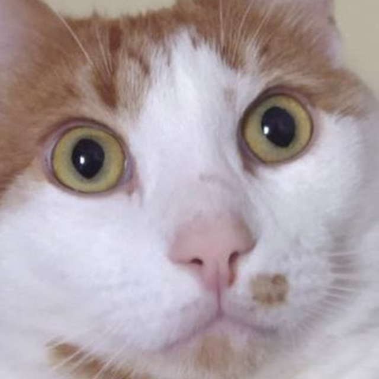
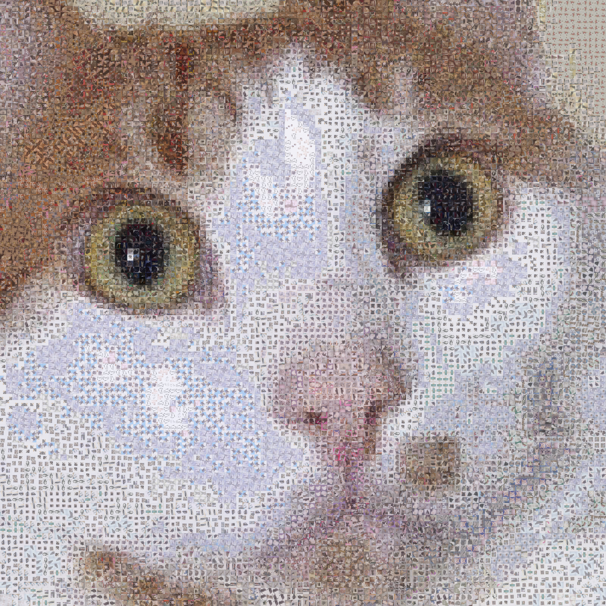

# Mosaicify
A tool that generates a mosaic image by replacing each region of a source image with the closest-matching image from a catalog based on average color.

| Target | Mosaic |
|---|---|
|  |  |

The mosaic is built from the 12,500 cat photos in Microsoft's [Kaggle Cats and Dogs Dataset](https://www.microsoft.com/en-us/download/details.aspx?id=54765). Open `out.jpg` at full size (6400×6400) to see the individual photos.

## Run locally

```bash
c++ -std=c++17 -O2 main.cpp -o mosaicify

# 825 MB zip, the cat photos unpack to about 400 MB
curl -fL -o /tmp/kagglecatsanddogs_5340.zip https://download.microsoft.com/download/3/E/1/3E1C3F21-ECDB-4869-8368-6DEBA77B919F/kagglecatsanddogs_5340.zip
mkdir -p images/cats
unzip -q -j /tmp/kagglecatsanddogs_5340.zip 'PetImages/Cat/*.jpg' -d images/cats

# scans images/cats and writes the cache, later runs can drop -d
# the cache stores paths relative to the current directory, so run from the repo root
./mosaicify -i cat.jpg -o out.png -d images/cats -c cache
```

`./mosaicify --help` lists the tuning flags, such as tile size, scale, and color filter strength.

This project uses the public-domain [stb libraries](https://github.com/nothings/stb) for image loading, resizing, and saving: `stb_image.h` for reading image files, `stb_image_resize2.h` for resizing images with high-quality filters, and `stb_image_write.h` for writing output images in common formats like PNG and JPEG.
